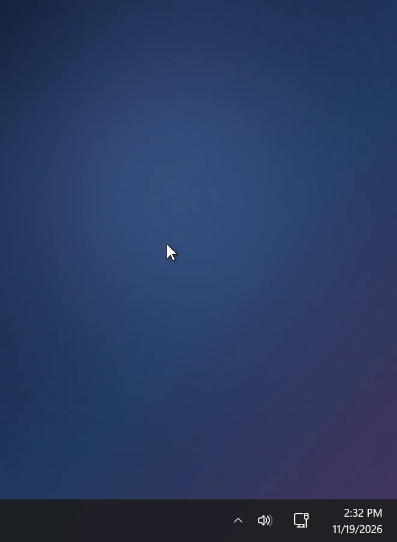
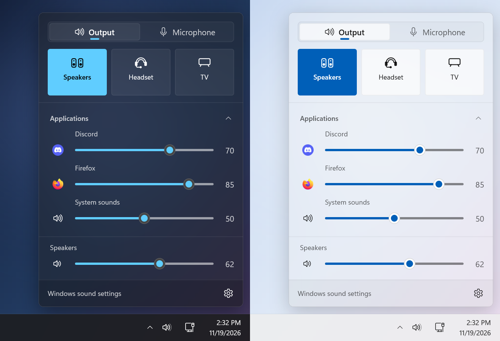
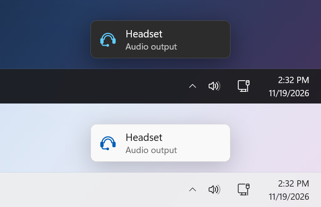
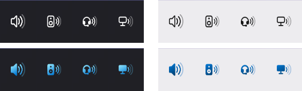
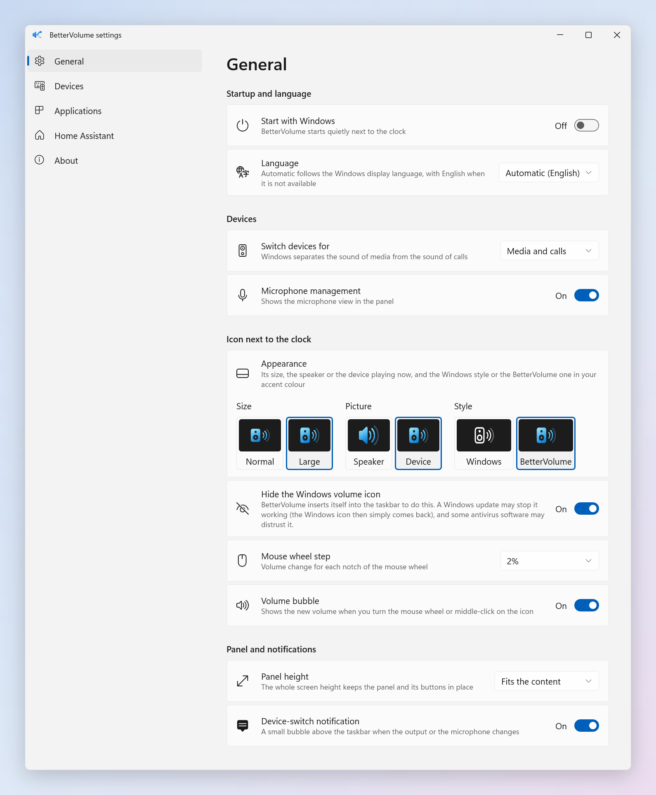

<p align="center">
  
</p>

# BetterVolume

[](https://github.com/machintrucbidule/BetterVolume/releases/latest)
[](https://github.com/machintrucbidule/BetterVolume/actions/workflows/ci.yml)
[](LICENSE)
[](#requirements)
[](#building-from-source)
[](#memory)

**The volume panel Windows 11 should have had.** One click on the tray icon to switch
between your speakers, headset and TV and set each application's volume, in a panel that
looks and moves like Windows 11, for a few megabytes of memory. Optionally linked to
Home Assistant.

<p align="center">
  
</p>

## Features

- **One click to change the output.** Every output device is a large tile; the current
  one is highlighted. Switch the media sound, the calls sound, or both (your choice).
- **Volumes.** Master volume and mute, the volume of each application playing sound, and
  a microphone view (input device, level, mute) that can be turned off.
- **From the tray icon.** The icon shows the volume level; the mouse wheel over it changes
  the volume, a middle click mutes, a right click opens the Windows sound screens and the
  settings. Three choices, each shown as a picture of the result in the settings: its
  size (normal, or large to take the same room as the icons next to it), its picture
  (the speaker, or the device playing now: speakers, headphones, headset, TV) and its
  style (identical to Windows, or the BetterVolume style in your Windows accent colour).
- **Looks like Windows 11.** The panel, the settings window and the small bubble shown
  when the device changes follow the Windows 11 design, light or dark theme and accent
  colour, and work with the keyboard and screen readers.
- **Your device list.** Rename devices, reorder them, choose their icon among 27 drawings,
  hide the ones you never use. Unplugged devices disappear and come back at their place.
- **Your application list.** Every application that played sound is remembered: choose
  its place in the panel, hide the ones you do not want to see there (their sound is not
  touched), or sort them alphabetically.
- **Home Assistant** (optional). Each PC appears as a device with its output, volume,
  mute, microphone and media buttons, updated live in both directions. Your automations
  can then, for example, switch the sound to the TV when it turns on, raise the volume
  while the robot vacuum runs, or lower it when someone rings at the door.
- **Can replace the Windows volume icon** (optional, off by default, see below).
- **Light.** A few megabytes of memory (about 3 MB just started, about 6 to 8 MB once
  the panel has been used; [details](#memory)), and practically no processor time while
  it waits (it only reacts to events).
- In English, French, German, Spanish, Italian, Portuguese (Brazil), Dutch, Polish,
  Japanese and Simplified Chinese; it follows the Windows display language.

<p align="center">
  
</p>

<p align="center">
  
</p>

<p align="center">
  
</p>

<p align="center">
  
</p>

## Requirements

Windows 11 (64-bit). No administrator rights are needed.

## Installation

Download one of the two files from the
[latest release](../../releases/latest):

- **`BetterVolume-<version>-setup.exe`** installs BetterVolume for your Windows account
  (in your user folder by default; the folder can be changed at the first installation).
  It adds a Start menu entry, can start BetterVolume with Windows, and appears in
  *Settings → Apps → Installed apps*, from where it can be uninstalled.
- **`BetterVolume-<version>-portable.exe`** is a single file that never installs
  anything: run it from any folder (a USB drive, for example). Its settings
  (`settings.toml`) and log file are kept next to it when that folder can be written,
  otherwise in your user profile.

### The Windows warning on first run

BetterVolume's files are not digitally signed (a code-signing certificate costs money
every year), so Windows does not know their publisher. When you open the file the first
time, Windows shows:

> **Windows protected your PC**
> Microsoft Defender SmartScreen prevented an unrecognized app from starting. Running
> this app might put your PC at risk.
> App: BetterVolume-2.0.0-setup.exe — Publisher: Unknown publisher

Click **More info**, then **Run anyway**. This happens once per file. Some browsers may
also say, while downloading, that the file "isn't commonly downloaded": open the
download list and choose **Keep**. Each release page lists the SHA-256 digest of its files, and
the program is built from this repository by the
[release workflow](.github/workflows/release.yml), so you can check what you run.

## Using it

Click the BetterVolume icon next to the clock to open the panel. If you do not see it,
it may be behind the **^** arrow of the taskbar; BetterVolume asks Windows to show it
directly on the taskbar the first time it starts.

The settings open from the gear button of the panel or from the right-click menu.

### Hiding the Windows volume icon

With BetterVolume, the taskbar would show two volume icons. The option *Hide the Windows
volume icon* (General page, also offered at the first start) hides the Windows one. To do
this, BetterVolume inserts a small helper into the taskbar; it touches nothing else and
puts the icon back when BetterVolume quits, when the option is turned off, or when it is
uninstalled. A Windows update may stop it working (the Windows icon then simply comes
back), and some antivirus software may distrust this technique. If the taskbar ever stops
right after the icon was hidden, the option turns itself off.

## Memory

What Windows Task Manager shows in its *Memory* column, measured on a test PC with the
release program (the figures vary a little from one PC to another):

| Situation | Memory |
|---|---|
| Just started, the panel not opened yet | about 3 MB |
| After the panel was opened (the drawing engine is kept for instant openings) | about 6 to 8 MB |
| While the settings window is open | about 11 MB |
| After the settings window was closed (the drawing engine is rebuilt at the next opening) | about 4 to 5 MB, 7 to 8 MB once the panel is opened again |

Home Assistant adds about half a megabyte. Each version is checked against a memory and
processor budget before it is released (see [Building from source](#building-from-source)).

## Updates

Once a day (and when you click **Check for updates** on the About page), BetterVolume
asks GitHub whether a newer version is published here. When there is one, a line at the
bottom of the panel offers it: **Install** downloads it, checks its size and digest, and
installs it (the installed version updates itself in one click; the portable file
replaces itself and restarts). Nothing is installed without your click.

- The automatic check can be turned off on the About page.
- **Receive preview versions** (About page, off by default) also offers test versions
  published before an official one.
- The request is the same for everyone and carries nothing about you or your PC.

## Home Assistant

BetterVolume talks to Home Assistant through an MQTT server (for example the Mosquitto
add-on) using MQTT discovery: no configuration is needed on the Home Assistant side.

1. In Home Assistant, set up the MQTT integration and its server if it is not done yet.
2. In BetterVolume's settings, page *Home Assistant*: turn the link on, enter the server
   address, port, user name and password, and choose how this PC is named. **Test
   connection** tells you what is wrong if it does not work; **Save** applies.

The PC then appears as a device with these controls:

| Control | Type |
|---|---|
| Audio output | select (your devices, in your order and names) |
| Volume, Mute | number (0–100), switch |
| Microphone, Microphone level, Microphone mute | the same three, when the microphone view is on |
| Play/pause, Next track, Previous track | buttons (like the keyboard media keys) |

The controls show as unavailable while the PC is off, asleep or BetterVolume is closed;
an output, volume or mute change ordered meanwhile is applied when the PC is back. Several
PCs can be connected, each with its own name. The password is stored encrypted for your
Windows account. An encrypted connection is supported; a server certificate Windows does
not know can be trusted explicitly.

## Uninstalling

*Settings → Apps → Installed apps → BetterVolume → Uninstall.* You can keep your settings
(the default) or delete them; deleting them also removes this PC from Home Assistant. The
Windows volume icon comes back. For the portable file, quit BetterVolume (right-click
menu → Quit) and delete the file with the `settings.toml` and `BetterVolume.log` next
to it.

## Privacy

BetterVolume sends nothing about you. The only network traffic is the update check
described above and, if you turn it on, the MQTT link to your own server. The log file
(*About → Log file*) holds technical events only, no names or addresses.

## Building from source

Requirements: Windows 11, [Rust](https://rustup.rs) with the MSVC toolchain (the version
is pinned in `rust-toolchain.toml` and installed automatically by `rustup`).

```
cargo build --release
```

The program is `target\release\BetterVolume.exe` (a development build: it does not check
for updates). One command runs every check a change must pass: formatting, lints
(warnings are errors), the unsafe-code policy, the tests, the release build, the release
files, a smoke test and the memory and processor budget:

```
powershell -ExecutionPolicy Bypass -File tools\check.ps1
```

BetterVolume must not be running while it measures. These checks only read the audio
state; `tools\audio-live.ps1` runs the tests that change it (default devices, volume,
mute), restoring everything at the end.

Releases: pushing a version tag (`v2.1.0`, or `v2.1.0-beta.1` for a preview) makes the
release workflow build the two files with the same checks and prepare a draft release.

| Path | Content |
|---|---|
| `crates/bv-core` | Pure logic: translations, settings, device lists, volume maths, Home Assistant payloads, release files, updates |
| `crates/bv-audio` | Windows Core Audio: devices, default switching, volumes, application sessions, live events |
| `crates/bv-ui-kit` | Design system: tokens, themes, controls and their rendering |
| `crates/bv-shell` | Windows plumbing: tray icon, windows, installation, updates, taskbar |
| `crates/bv-taskbar-helper` | The helper that hides the Windows volume icon inside the taskbar |
| `crates/bv-mqtt` | MQTT client for Home Assistant |
| `crates/bv-app` | The program: application state, installer, updater |
| `locales/` | Translation files |
| `tools/` | Checks, measurement, live audio tests, icon rendering, release files, update test |
| `docs/` | [Functional specification](docs/spec/FUNCTIONAL_SPEC.md), [design system](docs/spec/DESIGN_SYSTEM.md), [architecture](docs/ARCHITECTURE.md) |

## Translating

The translations other than English and French were written without a native speaker. If
a text sounds clumsy or wrong in your language, please open an issue on this project's
page with the better wording: it is the most helpful contribution there is.

To add a language, copy `locales/en.toml` to `<language tag>.toml` (for example
`sv.toml`), translate the texts, rebuild. The tests check that every language has the
same keys and placeholders as English. Contributions are welcome.

## Licence

[MIT](LICENSE)

## Why a version 2

The first BetterVolume was a small tool I wrote in C# (.NET) about fifteen years ago for
my own use, and it served me every day since. Over time it aged: it looked out of place
on Windows 11, and Windows updates kept breaking parts of it. Rather than patch it once
more, I decided to rebuild it from scratch with Claude. Version 2 is that rebuild,
rewritten in Rust with the Windows 11 look and a fraction of the memory: it keeps what
the first one did and adds Home Assistant control, settings and more languages.

## How this project is made

BetterVolume is developed by Claude, Anthropic's AI: it wrote the code, the tests and the
documentation, under the direction of the project's author. Quality does not rest on
trust: every change must pass the automated tests and checks (formatting, lints, the
memory and CPU budget), is read by a second, independent AI before it is kept, and each
version is tried by hand on a real PC before it is released.

The images on this page are drawn by the application's own code, not captured from a
screen (`crates/bv-app/src/app/readme.rs`, composed by `tools/readme-images.py`).
